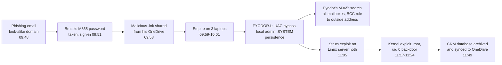

# Splunk BOTS v3 Breach Investigation

An end-to-end investigation of [Boss of the SOC v3](https://github.com/splunk/botsv3), Splunk's public dataset of a simulated breach at the fictional brewery Frothly: about 2 million events from email, Microsoft 365, Windows, Linux, network and AWS logs, all from one day.

The repo has:

- the incident report: timeline, indicators, ATT&CK mapping and recommendations
- 17 investigation queries
- 12 detections that would have caught the attack earlier, every one run against the data

**Read the full report:** [`report/incident-report.md`](report/incident-report.md)

## What happened



Three separate problems hit Frothly on the same day:

- **Leaked AWS key.** A web_admin key committed to public GitHub was used 43 seconds before AWS's warning email. Someone tried 576 crypto-mining instance launches in 15 regions, and all of them failed.
- **Public S3 bucket.** A bucket holding the website code was public for 56 minutes. An outsider wrote to it after 58 seconds and overwrote the code archive.
- **Browser coin miner.** Coinhive ran in one user's browser for 28 minutes and was blocked by antivirus on another laptop.

## What would have caught it earlier

None of these detections uses anything learned from the investigation (no attacker IPs, file names or accounts). Each was run against the whole dataset; results are in [`results/detections/`](results/detections/).

| # | Detection | ATT&CK | First alert | Sigma |
|---|---|---|---|---|
| D01 | [Look-alike sender domain](detections/splunk/D01-lookalike-sender-domain.spl) | T1566.002 | **09:48:17**, 36 s before the click | |
| D02 | [One IP signs in as several users](detections/splunk/D02-one-ip-signs-in-as-several-users.spl) | T1078.004 | 10:47:43 | |
| D03 | [Anonymous link to a shortcut or script](detections/splunk/D03-anonymous-link-to-shortcut-or-script.spl) | T1204.002 | 09:58:02, 106 s before the first stager | |
| D04 | [Browser launches hidden PowerShell](detections/splunk/D04-browser-launches-hidden-powershell.spl) | T1059.001 | 09:59:48, all 3 laptops | [yml](detections/sigma/D04-browser-launches-hidden-powershell.yml) |
| D05 | [UAC bypass via ms-settings](detections/splunk/D05-uac-bypass-ms-settings.spl) | T1548.002 | 10:07:05 | [yml](detections/sigma/D05-uac-bypass-ms-settings.yml) |
| D06 | [Local admin from the command line](detections/splunk/D06-local-account-added-to-administrators.spl) | T1136.001 | 10:08:17 | [yml](detections/sigma/D06-local-admin-from-command-line.yml) |
| D07 | [Windows Firewall turned off](detections/splunk/D07-windows-firewall-disabled.spl) | T1562.004 | 10:46:29 | [yml](detections/sigma/D07-windows-firewall-disabled.yml) |
| D08 | [Web service account runs shell commands](detections/splunk/D08-web-service-account-runs-shell-commands.spl) | T1190 | 11:06:07, about 11 min before root | [yml](detections/sigma/D08-java-spawns-shell.yml) |
| D09 | [Named pipe reverse shell / uid 0 account](detections/splunk/D09-linux-uid0-account-or-reverse-shell.spl) | T1059.004, T1136.001 | 11:13:03 | [a](detections/sigma/D09a-useradd-uid-0.yml) [b](detections/sigma/D09b-named-pipe-reverse-shell.yml) |
| D10 | [Mail copied outside / all-mailbox search](detections/splunk/D10-transport-rule-copies-mail-outside.spl) | T1114.002, T1114.003 | 10:48:28 | |
| D11 | [RunInstances failing in several regions](detections/splunk/D11-runinstances-failing-in-many-regions.spl) | T1496 | 09:16:22 | [yml](detections/sigma/D11-runinstances-failing-in-many-regions.yml) |
| D12 | [S3 bucket opened to everyone](detections/splunk/D12-s3-bucket-opened-to-everyone.spl) | T1530 | 13:01:46, 58 s before the first outside write | [yml](detections/sigma/D12-s3-acl-grants-everyone.yml) |

Each detection fired only on the attack. But BOTS v3 is one day of mostly attack data, so that doesn't show they'd be quiet on a real network. The report's [limitations](report/incident-report.md#8-limitations) cover this.

**Three things I took from it:**

1. **Every step was logged; none was alerted on.** D01, D03 and D04 all fire within 12 minutes of the phishing email, before any hands-on activity.
2. **"Cleaned" isn't "contained".** Symantec deleted the shortcut from Bruce's laptop at 09:58:20, but the same file stayed publicly shared from his OneDrive. The first colleague ran it 88 seconds later.
3. **A leaked cloud key is used within minutes.** The attacker had it before the warning email arrived.

## How I worked

- **Platform.** Splunk Enterprise 10.4 in Docker under WSL 2, listening on localhost only, with the dataset loaded as a pre-indexed app. Scripts are in [`setup/`](setup/).
- **No add-ons.** None were installed, so the Sysmon XML fields are pulled out with `rex` in each query.
- **Every query runs, and its output is saved.** [`scripts/run_spl.sh`](scripts/run_spl.sh) sends each `.spl` file to Splunk's REST API and saves the CSV. The report only states what a saved result shows.
- **Malware stays inert.** Encoded PowerShell was decoded with [`scripts/decode_enc.py`](scripts/decode_enc.py), which decodes base64 to text and never runs it. It also unwraps the nested base64 that hides Empire's C2 address. Microsoft Defender flags the fully decoded stager as Empire, so the repo keeps only the extracted indicators ([`results/decoded-payloads.txt`](results/decoded-payloads.txt)), not the payloads.
- **Sigma rules are validated in CI.** The [workflow](.github/workflows/sigma.yml) runs `sigma check`, failing on any issue, and converts every rule to Splunk SPL.

## Repo layout

```
report/incident-report.md   timeline, findings, indicators, ATT&CK, recommendations, limitations
queries/                    the investigation, step by step (01-15)
detections/splunk/          12 detections, tested against the dataset
detections/sigma/           9 Sigma rules for the detections that have a standard log source
results/                    saved output of every query and detection, plus iocs.csv
scripts/                    query runner, one-off query helper, offline payload decoder
setup/                      start Splunk with the dataset in Docker
```

## Run it yourself

1. Download `botsv3_data_set.tgz` from the [BOTS v3 repo](https://github.com/splunk/botsv3) (about 320 MB) and extract it to `/opt/bots/apps/` on a Linux or WSL host with Docker.
2. Run `sudo bash setup/start-splunk.sh`. It writes a random admin password to a root-only file and never prints it.
3. Run `sudo bash scripts/run_spl.sh queries results/queries` and `sudo bash scripts/run_spl.sh detections/splunk results/detections`.

Each `.spl` file also pastes straight into the Splunk search bar; text between ``` marks is a Splunk comment. Search over **All time**, because the data is from 2018.

> BOTS v3 was written by the Splunk BOTS team (Ryan Kovar, David Herrald, James Brodsky, John Stoner, Jim Apger, David Veuve, Lily Lee and Matt Valites) and released under CC0. Frothly and its staff are fictional. This repo contains no part of the dataset beyond small query results.

---

*Part of my security portfolio. See also: [SOC monitoring lab (Sentinel)](https://github.com/BharathwajM/soc-portfolio-lab) · [AD attack detection lab (Splunk)](https://github.com/BharathwajM/ad-attack-detection-lab) · [Phishing triage tool (Python)](https://github.com/BharathwajM/phishing-triage-automation) · [Essential Eight hardening lab (PowerShell)](https://github.com/BharathwajM/essential-eight-lab).*
